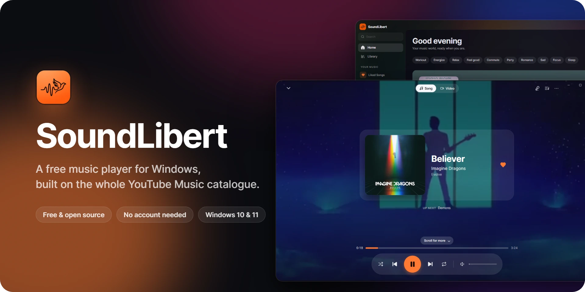
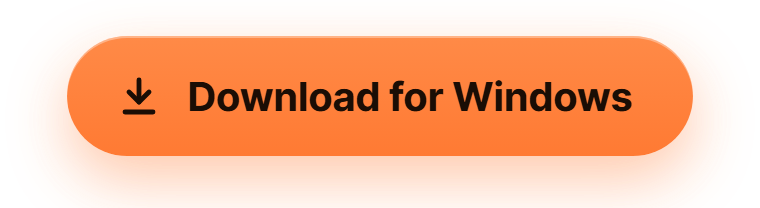
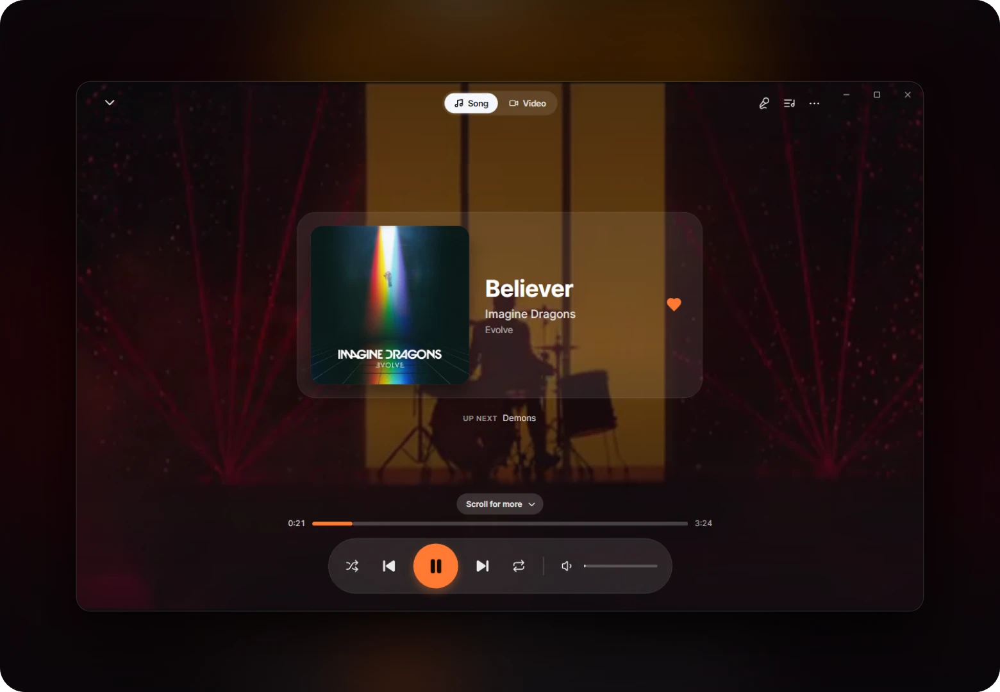
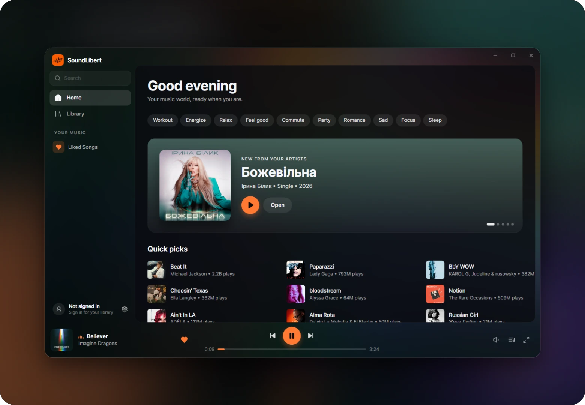
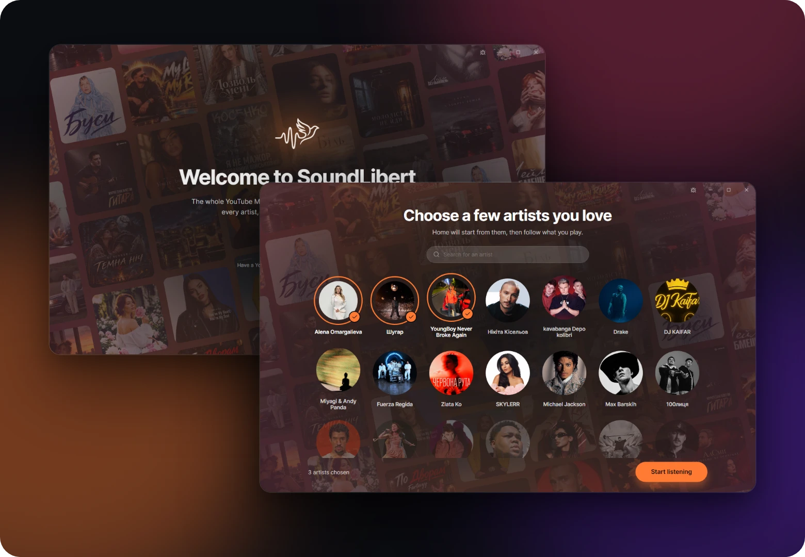
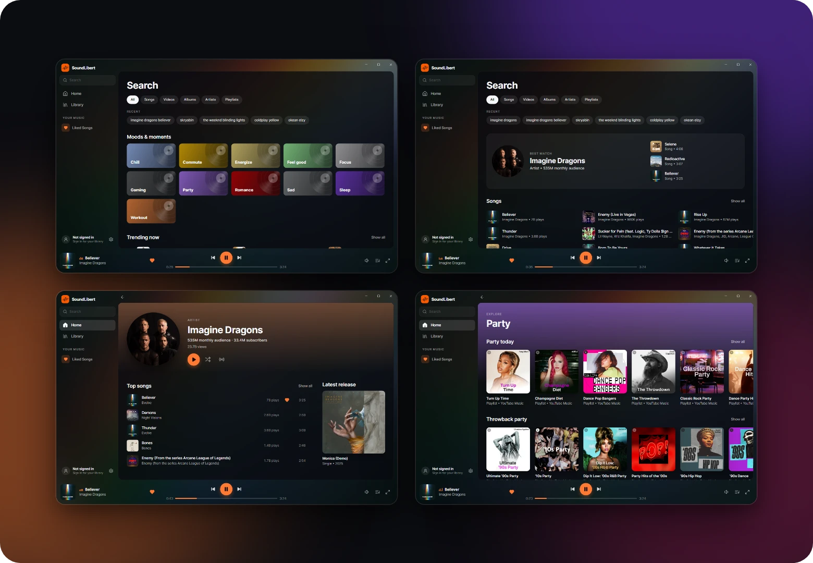
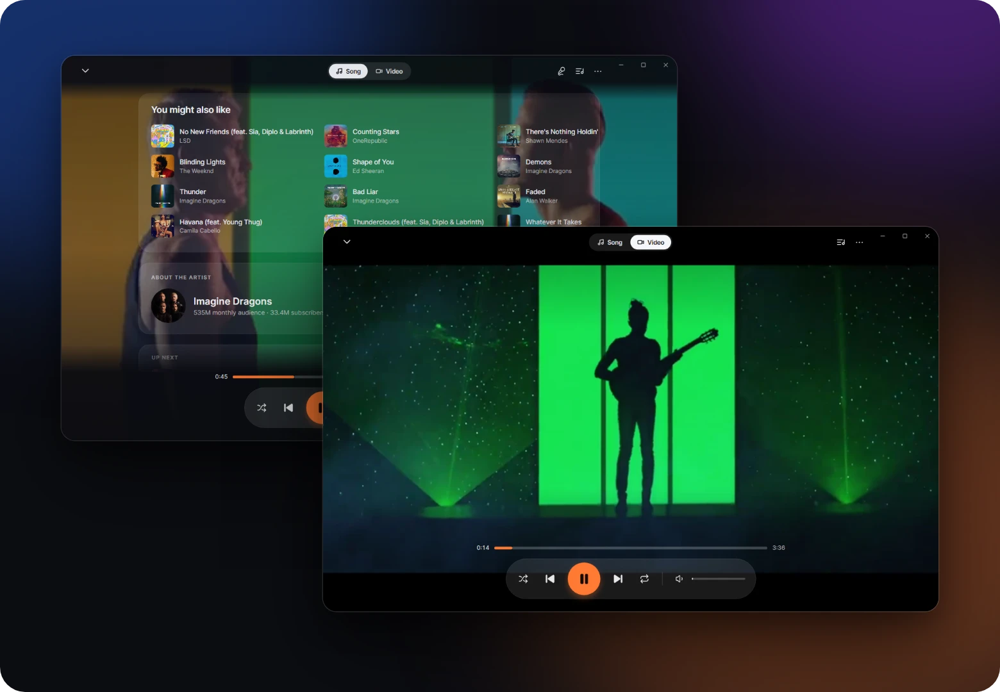

<p align="center">
  
</p>

<p align="center">
  <a href="https://github.com/VasilKotik/SoundLibert/releases/latest"></a>
</p>

<p align="center">
  <a href="https://github.com/VasilKotik/SoundLibert/releases/latest"></a>
  
  <a href="LICENSE"></a>
</p>

<p align="center">
  SoundLibert plays the whole YouTube Music catalogue in a calm, living window.<br>
  The colours of the cover flow behind everything, and every artist, album and playlist leads to the next.
</p>

<p align="center">
  <b>Free and open source</b> &nbsp;·&nbsp; <b>No account needed</b> &nbsp;·&nbsp; <b>No telemetry</b> &nbsp;·&nbsp; <b>Updates itself</b>
</p>

<p align="center">
  <a href="#download">Download</a> &nbsp;•&nbsp;
  <a href="#everything-a-player-needs">Features</a> &nbsp;•&nbsp;
  <a href="#questions">Questions</a> &nbsp;•&nbsp;
  <a href="#privacy">Privacy</a> &nbsp;•&nbsp;
  <a href="#build-from-source">Build from source</a>
</p>

<br>

<h3 align="center">The song fills the screen</h3>
<p align="center">
  The official music video loops behind the song, muted, with its black bars trimmed away.<br>
  Scroll down for songs like it, the artist and what plays next.
</p>



<br>

<h3 align="center">Something new every time</h3>
<p align="center">
  Home mixes YouTube Music's picks with songs like yours, new releases from your artists, the charts of your country and moods for the time of day.<br>
  It changes when you come back and keeps going as you scroll.
</p>



<br>

<h3 align="center">It starts with you</h3>
<p align="center">
  The first time you open SoundLibert, choose a few artists you love, or search for anyone.<br>
  Home is built from them from the very first minute, then follows what you play.
</p>



<br>

<h3 align="center">Find anything</h3>
<p align="center">
  Search opens on moods, genres and charts, and answers with the best match first.<br>
  Artist pages show their audience, top songs, latest release and everything they have made.
</p>



<br>

<h3 align="center">Watch the video</h3>
<p align="center">
  Switch to <b>Video</b>, and the official clip plays with sound, full screen.<br>
  In Song mode, everything related waits below the song.
</p>



## Everything a player needs

- **Synced lyrics**, timed to the exact recording that plays: full screen, or one line under the cover.
- **Your library**: liked songs, playlists with cover mosaics, history, offline downloads and your own MP3, FLAC, WAV and M4A files.
- **Optional sign-in** brings your YouTube Music likes, playlists, albums and subscriptions. It is read-only: SoundLibert never changes anything in your account.
- **A complete player**: a queue you reorder by dragging, radio from any track, a sleep timer, a mini player, crossfade, loudness normalisation, EQ presets and your choice of output device.
- **At home in Windows**: media keys, the Windows media overlay, progress on the taskbar button and close to tray.
- **Always up to date**: new versions download in the background, and a card shows what is new in them before you restart.

<details>
<summary><b>Keyboard shortcuts</b></summary>
<br>

| Keys | Action |
| --- | --- |
| <kbd>Space</kbd> | Play or pause |
| <kbd>←</kbd> <kbd>→</kbd> | Seek 5 seconds |
| <kbd>Ctrl</kbd> + <kbd>←</kbd> <kbd>→</kbd> | Previous or next track |
| <kbd>↑</kbd> <kbd>↓</kbd> | Volume |
| <kbd>M</kbd> | Mute |
| <kbd>Ctrl</kbd> + <kbd>K</kbd> | Search |
| <kbd>F</kbd> | Full player |
| <kbd>F11</kbd> | Window full screen |
| <kbd>Alt</kbd> + <kbd>←</kbd> or <kbd>Esc</kbd> | Back, or close |
| <kbd>F1</kbd> | All of these, in the app |

</details>

## Download

Get `SoundLibertApp-win-Setup.exe` from the [latest release](https://github.com/VasilKotik/SoundLibert/releases/latest). It installs for your user only, needs no admin rights and keeps itself up to date.

- Windows 10 (1809) or newer, 64-bit.
- Signing in needs the Microsoft Edge WebView2 Runtime. Windows 11 already has it.
- Windows "N" editions also need Microsoft's Media Feature Pack, or songs cannot play.

> [!NOTE]
> The installer is not code-signed yet, so Windows SmartScreen may warn about an unrecognised app. Choose **More info → Run anyway**.

## Questions

<details>
<summary><b>Is it really free?</b></summary>
<br>
Yes. SoundLibert is free and open source under the GPL-3.0 licence. There is nothing to buy and no account to create.
</details>

<details>
<summary><b>Do I need a Google account?</b></summary>
<br>
No. Everything works without signing in. Signing in only brings your YouTube Music library into the app: likes, playlists, albums and subscriptions.
</details>

<details>
<summary><b>Will it change anything in my YouTube Music account?</b></summary>
<br>
Never. The sign-in is read-only. Likes, playlists and follows you make in SoundLibert stay on your PC.
</details>

<details>
<summary><b>How do updates work?</b></summary>
<br>
SoundLibert checks this repository's releases in the background. A new version downloads by itself, and a card shows what is new in it: restart when you like, or it installs the next time you open the app. <b>Settings → Updates</b> shows where things stand and lets you check by hand.
</details>

<details>
<summary><b>Where is my library kept, and how do I remove everything?</b></summary>
<br>
Your library, history, settings and downloads stay in <code>%LocalAppData%\SoundLibert</code>. Uninstalling the app (Windows Settings → Apps) keeps them, so a reinstall picks up where you left off. To remove everything, delete that folder too.
</details>

<details>
<summary><b>A song doesn't play. What can I do?</b></summary>
<br>
On Windows "N" editions, install Microsoft's Media Feature Pack first. Otherwise, press the bug button at the top of the window: the report includes the app's log, which shows what went wrong.
</details>

<details>
<summary><b>Is there a version for Mac or Linux?</b></summary>
<br>
Not yet. SoundLibert is made for Windows 10 and 11 for now.
</details>

## Privacy

- No telemetry, no analytics.
- Your library, history, settings and downloads stay on your PC, in `%LocalAppData%\SoundLibert`.
- Signing in is optional. The session is stored encrypted on this device only (Windows DPAPI) and goes nowhere but YouTube Music. Signing out deletes it, along with the sign-in window's browser data.
- To find lyrics and genres, the title and artist of a track are sent to [LRCLIB](https://lrclib.net) and to Apple's iTunes Search API. Nothing about you or your account goes with them.
- Bug reports are only ever sent by you. The report shows exactly what will be shared, with IP addresses, emails, link parameters and your Windows user name removed.

## Feedback and contributing

Found a bug? Press the bug button at the top of the window, or [open an issue](https://github.com/VasilKotik/SoundLibert/issues/new). Ideas and pull requests are welcome too. For a bigger change, open an issue first, so we can talk it over.

If you like SoundLibert, star the repository and tell a friend. It helps other people find it.

## Build from source

You need Windows 10 or 11 (x64) and the [.NET 10 SDK](https://dotnet.microsoft.com/download).

```powershell
dotnet build SoundLibert.slnx
dotnet run --project SoundLibert.UI
dotnet test
```

`release.ps1` makes the installer and the update packages (Velopack).

## Developers

<table>
  <tr>
    <td align="center" width="160">
      <a href="https://github.com/VasilKotik"><br><b>VasilKotik</b></a><br>
      <sub>Creator</sub>
    </td>
    <td align="center" width="160">
      <a href="https://github.com/kiku-jw"><br><b>kiku-jw</b></a><br>
      <sub>Synced lyrics</sub>
    </td>
  </tr>
</table>

## License

SoundLibert is free software under the [GNU General Public License v3.0](LICENSE). It builds on ideas and ported logic from [Velune](https://github.com/nikhilvishwakarma00/Velune) (GPL-3.0). Every third-party component is listed in [CREDITS.md](CREDITS.md).

<sub>SoundLibert is an unofficial client. It is not affiliated with, endorsed by or sponsored by YouTube or Google. All music, videos, artwork and lyrics belong to their rights holders.</sub>
